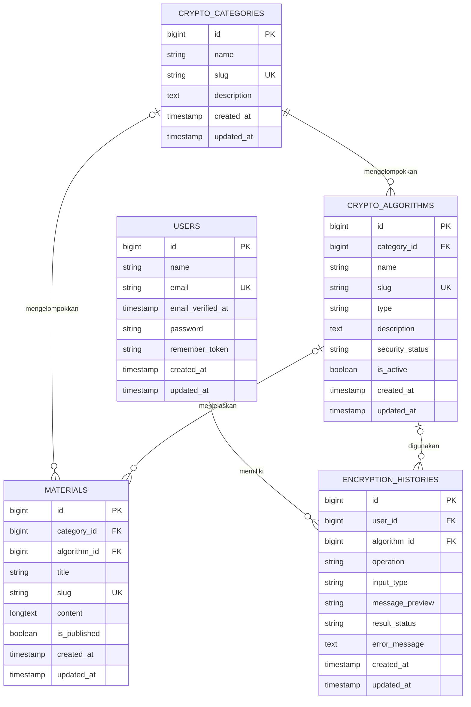

# CryptoLab

CryptoLab merupakan ruang belajar digital yang dirancang untuk mengenalkan dunia kriptografi melalui pembelajaran dan praktik secara langsung. Pengguna dapat mempelajari berbagai algoritma, memahami konsep enkripsi dan dekripsi, serta melakukan simulasi melalui fitur laboratorium. Dengan tampilan yang interaktif dan fitur yang terstruktur, CryptoLab membantu proses belajar kriptografi menjadi lebih praktis, menarik, dan mudah dipahami.

## Fitur

- **Akun pengguna** — registrasi, login, dan logout.
- **Dashboard** — ringkasan kategori, algoritma aktif, materi, dan aktivitas terbaru pengguna.
- **Materi kriptografi** — daftar materi yang dipublikasikan, halaman detail, dan filter berdasarkan kategori.
- **Lab algoritma** — demonstrasi block cipher, stream cipher, hash, MAC, algoritma kunci publik, dan konsep matematika.
- **Hybrid Trio** — lab yang memperlihatkan proses kaskade A5/1, RC4, dan ChaCha20 beserta paket enkripsi dan jejak komputasi.
- **Riwayat pribadi** — daftar dan ringkasan operasi berhasil maupun gagal untuk akun yang sedang login.

Halaman materi dapat dibaca tanpa login. Dashboard, lab, riwayat, dan daftar akun hanya tersedia setelah login. Proses login dan registrasi memiliki pembatasan frekuensi permintaan.

## Katalog demonstrasi

Lab mencakup, antara lain:

- **Block cipher dan mode operasi:** AES-GCM, Twofish, Camellia, 3DES, DES, Blowfish, IDEA, RC5, RC6, CAST-128, SEED, Serpent, Skipjack, serta ECB, CBC, CFB, OFB, dan CTR.
- **Stream cipher:** RC4, A5/1, A5/2, LFSR, OTP, ChaCha20, Salsa20, Rabbit, Trivium, dan Hybrid Trio.
- **Hash dan autentikasi:** SHA-256, SHA-512, SHA-3, MD5, SHA-1, HMAC-SHA256, dan CMAC-AES.
- **Kunci publik dan tanda tangan:** RSA-OAEP, RSA-PSS, RSA signature, ECC/ECIES, DSA, ElGamal, ECDH, dan ECDSA.
- **Matematika kriptografi:** aritmetika modulo, GCD, Euclid diperluas, bilangan prima, faktorisasi, fungsi Euler, medan hingga, logaritma diskrit, dan kurva eliptik.

Daftar yang dapat dijalankan menyesuaikan dukungan OpenSSL dan ekstensi PHP pada mesin. Katalog di lab adalah implementasi demonstrasi; algoritma lama atau lemah seperti DES, RC4, MD5, dan SHA-1 diberi konteks edukasi dan tidak dianjurkan untuk melindungi data sungguhan.

## Teknologi

- PHP **8.3 atau lebih baru**
- Laravel **13**
- SQLite sebagai basis data bawaan
- OpenSSL dan phpseclib untuk sejumlah engine kriptografi
- Vite, Tailwind CSS, dan npm untuk aset frontend
- PHPUnit untuk pengujian

## Menjalankan secara lokal (Windows/Laragon)

Pastikan PHP, Composer, Node.js/npm, dan ekstensi PHP yang dibutuhkan proyek tersedia di terminal.

```powershell
composer install
Copy-Item .env.example .env
New-Item -ItemType File -Force database/database.sqlite
php artisan key:generate
php artisan migrate --seed
npm install
npm run build
php artisan serve
```

Buka alamat lokal yang ditampilkan Artisan, biasanya `http://127.0.0.1:8000`. Untuk mengembangkan frontend sambil menjalankan aplikasi, gunakan `npm run dev` di terminal terpisah.

Seeder mengisi kategori, katalog algoritma, dan materi awal. Jika perlu mengulang skema dari awal pada basis data lokal, jalankan `php artisan migrate:fresh --seed`; perintah ini menghapus data pada basis data yang dipilih, jadi jangan jalankan pada basis data yang berisi data penting.

### Konfigurasi

Salin `.env.example` ke `.env`, lalu sesuaikan konfigurasi untuk lingkunganmu. Konfigurasi contoh memakai SQLite dengan berkas `database/database.sqlite`. Jangan unggah `.env`, kredensial, atau kunci aplikasi ke repositori.

## Pengujian

Jalankan seluruh pengujian dengan:

```powershell
php artisan test
```

Pengujian menggunakan SQLite dalam memori dan mencakup engine kriptografi, alur lab, autentikasi, materi, serta pencatatan riwayat.

## Alur Hybrid Trio

Lab Hybrid Trio mengenkripsi data dengan urutan A5/1 → RC4 → ChaCha20. Dari passphrase dan salt acak, HKDF menurunkan subkunci terpisah untuk setiap cipher dan untuk autentikasi. Setiap operasi enkripsi menghasilkan salt 16 byte dan nonce 12 byte baru. Tag HMAC-SHA256 dihitung atas salt, nonce, dan ciphertext; pada dekripsi, tag diperiksa sebelum plaintext dipulihkan.

Lab juga menyediakan jejak per karakter dalam mode ASCII 7-bit untuk membantu pembelajaran. Jejak visual tersebut merupakan penyederhanaan untuk demonstrasi, bukan representasi keluaran byte penuh untuk semua data. Kaskade ini tetap merupakan eksperimen edukasi dan tidak boleh dianggap sebagai rancangan kriptografi yang telah diaudit untuk penggunaan produksi.

## Struktur data dan ERD

ERD berikut merangkum tabel domain aplikasi. `1` ke `0..N` berarti satu baris induk dapat memiliki nol atau banyak baris anak. Relasi materi ke kategori/algoritma dan riwayat ke algoritma bersifat opsional karena foreign key-nya nullable.



### Penjelasan relasi dan tabel

| Tabel | Fungsi |
|---|---|
| `users` | Akun aplikasi. Email bersifat unik dan password disimpan dalam bentuk hash oleh Laravel. |
| `crypto_categories` | Pengelompokan materi dan algoritma, seperti Block Cipher, Stream Cipher, Fungsi Utama, dan Dasar Matematika. |
| `crypto_algorithms` | Katalog algoritma; setiap algoritma wajib memiliki kategori. Jika kategori dihapus, algoritmanya ikut dihapus. |
| `materials` | Materi berisi judul, slug, konten, dan status publikasi. Kategori dan algoritma terkait boleh kosong; jika induk dihapus, referensinya dibuat `NULL`. |
| `encryption_histories` | Catatan operasi per pengguna: algoritma (opsional), jenis operasi, tipe input, cuplikan pesan, status, dan pesan kesalahan. Jika akun dihapus, riwayatnya ikut dihapus; jika algoritma dihapus, referensinya dibuat `NULL`. |

Riwayat menyimpan cuplikan input maksimal 60 karakter untuk tampilan aktivitas, bukan paket ciphertext lengkap atau passphrase. Indeks pada `user_id` bersama waktu pembuatan dan status membantu pencarian riwayat pengguna.

Laravel juga membuat tabel pendukung seperti `sessions` dan `password_reset_tokens`; tabel tersebut tidak ditampilkan dalam ERD domain di atas.

## Catatan keamanan

CryptoLab dikembangkan sebagai media pembelajaran untuk memahami dasar-dasar kriptografi melalui simulasi dan eksperimen. Algoritma yang tersedia mungkin menggunakan metode sederhana atau teknik yang sudah tidak direkomendasikan untuk kebutuhan keamanan modern. Beberapa proses juga menggunakan parameter khusus agar hasil simulasi lebih mudah dipahami dan dapat diulang. Oleh karena itu, aplikasi ini hanya ditujukan untuk keperluan edukasi dan tidak disarankan untuk melindungi informasi penting atau data yang bersifat rahasia.

## Lisensi

Proyek ini menyediakan kode di bawah lisensi MIT. Lihat berkas lisensi atau metadata dependensi terkait untuk ketentuan komponen pihak ketiga.
